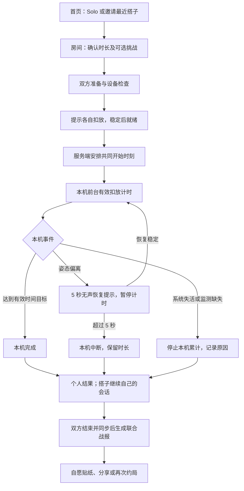

# SAVAGE App 产品需求文档 v4.1

> 重力契约 · 熟人共同专注 · 跨平台验证版  
> 更新日期：2026-10-15  
> 状态：产品与工程评审稿；未实施、未完成真机验证、未取得商店审核结果。  
> 基于用户提供的 v4.0 完善。本文中的“产品决定”是本版建议基线；实验指标、算法参数和商业价格均不是已验证结论。

**阅读路径**：产品/设计优先看第 0–4 节；客户端与服务端看第 3、5–7、11 节；运营与商业看第 8–10、12 节。第 13 节集中列出官方参考资料。

## 0. 本次修订摘要

保留“快捷约局、共同扣放、独立计时、结束后互动”的核心体验，把产品承诺限定为可观测的设备行为。第一阶段验证熟人共同专注的复用价值，商业化在可靠性和留存得到支持后逐步开放。

| v4.0 原表述或缺口 | v4.1 处理 |
|---|---|
| 100% 过审、全美绝对合规 | 删除保证性措辞；功能、内容、支付与隐私分别评审 |
| 最低亮度黑屏并强制锁定设备 | 改为前台暗色界面与必要的保持唤醒；不阻止锁屏、退出或接电话 |
| 高优先级静音推送保证极速入局 | 改为可见邀请通知、深链及房间入口；同步依赖前台连接，不依赖推送 |
| iOS/Android 直接比较负 Z 值 | 增加平台适配、单位与方向归一化、真机正反面校验 |
| 3 秒校准完全消除传感器差异 | 改为能力检测和有限校准；不合格设备降级为明确标注的普通计时 |
| 拿起后红屏闪烁、语音催促 | 改为本机无声恢复提示；默认无震动、无闪烁，娱乐放在结算后 |
| 25/50 分钟究竟指墙钟还是有效时间不明确 | 统一为累计有效扣放时间；5 秒恢复期不计入，个人独立结束 |
| 所有断网都记 Unverified | 分离网络同步状态与传感器证据状态；离线有效记录可以补传 |
| 手动复核覆盖机器结果 | 人工确认单独保存，不补造传感器时间，不改写设备记录 |
| 总分钟数较多就认定胜者 | 双人同目标且证据完整时才适用可选挑战；系统异常不触发后果 |
| 首次同时填写两个人的学校邮箱 | 各自接受邀请；学校邮箱非必填，不代填朋友的个人信息 |
| iOS TestFlight 覆盖跨平台内测 | iOS 使用 TestFlight，Android 使用 Google Play 测试轨道 |
| 声优、卡包、订阅同时做 | 核心闭环为 P0；表达包、语音、小组订阅分期验证 |

## 1. 产品定位与证据边界

### 1.1 一句话定位

**让固定学习搭子更容易一起开始，并完成一段不翻起手机的时间。**

面向美国 18 岁及以上、已有固定学习搭子的大学生。加拿大等其他北美市场后置，不以“北美首发”代替国家级上线评估。

核心体验：约同一个搭子 → 确认 25/50 分钟 → 各自扣下手机 → 安静完成 → 查看记录与可选吐槽 → 再约一次。

### 1.2 首批用户与使用场景

| 人群/场景 | 需要完成的事 | 优先级 |
|---|---|---|
| 同桌自习的两位朋友 | 从聊天切换到学习，减少习惯性拿手机 | P0 |
| 已有固定搭子的异地自习 | 约定同一时间开始，结束后相互汇报 | P0；与同桌数据分开分析 |
| 搭子暂时不在 | 独自开始一次相同规则的专注 | P0 |
| 临时陌生人匹配、全校竞技 | 认识新朋友、争排名 | 不进入首期 |

期末周是招募场景，不是长期市场成立的证据。探索阶段同时招募正常教学周的用户。

### 1.3 有意不承诺的能力

- 设备面朝下、传感器变化较小，不等于用户认真学习，也不能证明设备接触桌面。
- 不监测其他设备；不证明用户没有刷电脑、发呆或作弊。
- 不宣称治疗 ADHD、手机成瘾或保证改善成绩。
- 不保证通知准时到达、两台设备毫秒级同时启动或全机型可靠。
- “共同确认”代表用户陈述，不代表自动验证通过。
- 不以禁止某些词汇、服务协议免责声明或“技能型”命名替代合规判断。

### 1.4 竞品基线

| 产品 | 已核实的公开信息 | 对 SAVAGE 的含义 |
|---|---|---|
| FocusDown | 商店描述包括翻转启动、好友实时房间；版本记录包括好友专注对战、等级和分享 | “翻转 + 熟人社交”不是独占组合 [S1] |
| Focumon | 支持实时共同专注、链接邀请朋友、可选小组 | 不能将社交竞品统称为异步或陌生人社区 [S2] |
| Google We Flip | 历史实验：一起拨动界面开关，有人解锁则结束；现已不活跃 | 熟人同步离开手机已有先例；不是物理翻转产品 [S3] |

以上为官方页面和商店公开描述，不构成实际体验、留存或营收验证。SAVAGE 的差异化目标是更快的固定搭子开局、更清楚的异常处理和不打扰的结算互动，不使用“全美第一”“不可替代”等宣传。

## 2. 产品目标、范围与阶段

### 2.1 待验证假设

| 编号 | 假设 | 证据要求 |
|---|---|---|
| H1 | 双人共同开始比单纯约定时间更容易促成开局 | 邀请到双方实际开始的转化及开局耗时 |
| H2 | 翻转比普通双人计时增加可感知价值 | 同组轮换体验、有效完成、主动偏好与退出原因 |
| H3 | 结束后的轻量吐槽增加复用，且不增加不适 | 有/无吐槽的复用趋势、关闭率与访谈 |
| H4 | 新鲜感下降后仍有需求 | 第 3–4 周的真实再次开局、正常教学周使用 |
| H5 | 部分用户愿意为增值功能支付 | 明示价格的真实购买；不以问卷意愿替代 |

### 2.2 功能优先级

| 优先级 | 范围 | 交付目的 |
|---|---|---|
| P0 技术探针 | 两端姿态、前台生命周期、保持唤醒、计时、耗电、异常记录 | 确认核心体验能可靠运行 |
| P0 产品内测 | Solo、双人邀请、最近搭子、25/50 分钟、5 秒恢复、独立结果、离线补传、少量预设贴纸、隐私与举报/屏蔽 | 验证真实复用 |
| P0 可选挑战 | 双方明确接受的少量非财物、非公开羞辱挑战；默认关闭 | 探索熟人约定的增量价值 |
| P1 | 个性化主题、更多授权贴纸、预约下一场、长期统计、商店内购试点 | 留存和付费验证 |
| P2 | 多人小组、语音包、复杂成长系统、扩展国家 | 有证据后单独立项 |
| 不做 | 钱包、扣款惩罚、现金/咖啡券赌注、翻倍复仇、公开黑榜、陌生人匹配、全国排行榜、自动发帖、实时干扰攻击 | 保持首期边界 |

跨平台为验收范围，不要求首日双商店公开发布。允许先完成一端探针，再补齐另一端；混合设备闭环通过后才能对外宣称支持混局。

### 2.3 暂定支持范围

- 手机竖屏为主要形态；平板、多窗口、折叠屏展开态不进入首轮承诺范围。
- 工程估算基线：iOS 17+、Android 12+；最终最低系统版本在设备探针后确认。SDK 和 target API 使用提交时平台要求。
- Android 首轮重点覆盖具备 Google Play 服务的美国市场机型；无相关服务的设备仍需有房间入口，通知兼容扩展后置。
- 不支持可靠姿态检测的设备仍可使用普通 Solo 计时，明确显示“普通计时”；不得混入重力挑战榜或冒充重力记录。

## 3. 统一业务规则

### 3.1 三个必须分开的概念

1. **个人结果 outcome**：完成、中断、取消、超时。
2. **记录完整性 evidence**：设备记录完整、设备记录部分缺失、待核实。
3. **同步 sync**：本地待上传、已同步、需要重试。

网络断开不自动改变 evidence；传感器缺失不等于用户失败；朋友确认不自动把 evidence 变成完整。

面向用户使用“扣放记录完整”“记录缺失”“朋友确认”。不使用“真实学习证明”“绝对可信”等措辞。客户端记录不是防篡改证明，首期不承接财物清算或高价值排名。

### 3.2 计时口径：有效时间目标

**25/50 分钟表示累计有效扣放时间，不是包含中断的墙钟时长。**

- 开始前稳定检测的 2 秒不计入。
- 仅在 App 活跃前台、传感器样本连续可用、姿态满足条件时累计有效时间。
- 5 秒恢复提示期间暂停累计。成功恢复不抹去此前有效时间，但本段恢复时间不补计。
- 拿起超过 5 秒，本次个人挑战结束为中断；如想继续，创建新的 Solo 会话，不覆盖原记录。
- 每人累计达到目标即完成，可以比搭子稍晚结束。每人最长墙钟时间为目标 + 60 秒；仍未达标则记“超时结束”，保留有效时间。
- 使用单调时钟和传感器时间戳计算时长；系统日期修改不改变有效时间。倒计时不得依靠定时器触发次数累加。
- 内部保留毫秒级时长，界面显示分秒；汇总分钟向下取整，不将 24:59 标为完成 25 分钟。
- 不连续或超过允许采样间隔的区间不计入；崩溃后无法恢复的区间不推算为扣放。
- 同一边界出现“达到目标”和“拿起/失活”时，先将可靠区间截断到最早中断时间：若该时间之前已累计达到目标则完成，否则按中断规则处理。不能由网络消息到达顺序决定输赢。

例：25 分钟会话中拿起 3 秒并成功扣回，最终需约 25 分钟 3 秒的墙钟时间才累计完成目标。若在有效时间 18:20 时拿起超过 5 秒，则结果为“中断，已记录 18:20”。

### 3.3 个人完成与房间结束

- 一人完成/中断不停止另一人。只要另一端仍活跃前台且传感器正常，就继续独立记录；进入后台则按自己的生命周期规则处理。
- 已结束者立即看到自己的结果；搭子仍进行时只显示“对方尚未结束”，不提供催促按钮。
- 双方都终止后生成联合战报。服务端到达房间最晚截止时间仍未收到一方结果时，生成“等待同步”的暂定战报，不判对方失败。
- 截止时间按双方已接受的个人开始时间及“目标 + 60 秒”计算；允许网络对账缓冲，默认 120 秒。
- 迟到的有效本地记录在房间最晚个人截止时刻起算的 24 小时补传窗口内可更新证据和战报版本；不得触发第二次积分发放。窗口结束仍缺失的记录以“未收到完整记录”结案，挑战豁免。过期记录只保留在个人历史并解释原因，不追溯触发挑战后果。
- 已分享的图片不远程改写。App 内显示最新战报及“结果已更新”；暂定战报不提供对战胜负或挑战后果。

### 3.4 双人轻量挑战

- 默认“不设挑战”，双人专注本身完整可用。
- 仅限固定预设，例如“给对方写一句夸奖”“下次自习由我选座位”“自愿整理自己的学习桌”。不涉及金钱、购买、身体风险、隐私披露或公开羞辱。
- 双方看到完全相同的版本并分别确认。可以不限次数拒绝并切换为无挑战；拒绝不会成为失信记录。
- 时长、对象、挑战内容任意修改，都清除双方旧确认；启动前锁定规则快照。
- 仅在双方均开始、目标一致、记录完整、无系统异常、联合结果最终确定时评估后果：一人完成，另一人因明确主动结束或前台姿态偏离超时而中断，才提示中断者履行约定。
- 双方完成、双方中断、尚未同步、启动不同步、系统中断、超时、证据不足：均不产生后果；保留个人记录。
- 线下履约状态为“未确认 / 本人表示已完成 / 双方确认 / 双方取消 / 有争议”。不自动催付、不标“无赖”、不扣功能权限。
- 对方可以拒绝分享和吐槽；退出、屏蔽或撤销挑战不触发追加惩罚。已经记录的事实与后续社交确认分别保存。

### 3.5 Streak 与成长

- P0 只做个人连续完成天数与累计扣放时间，不做竞争段位。
- 一天至少一场达到目标且设备记录完整的会话，计一个完成日；Solo 与双人等价。
- 记录部分缺失和朋友确认可显示在历史，但不增加“设备记录完整”的成就。离线完整记录补传后可补记，不重复累计。
- 完成日使用会话开始时保存的用户时区计算；修改时区不改写历史。只记录低价值成长，不宣称具备强反作弊能力。
- 单次中断不清零历史时长；当天仍可通过下一场完成获得完成日。
- 等级仅用于未来外观解锁，不能锁住 Solo、双人基础功能或异常申诉。

### 3.6 产品规则的取舍

为避免把无监测时间当成完成，本版采用保守规则：失去活跃前台即停止当前重力会话。这会让短暂系统浮层也造成中断，是明确的体验成本，须在内测中观察；若影响过大，应另行设计“可暂停、无胜负的共同计时模式”，不能悄悄将监测空档计为有效时间。

5 秒内恢复和系统中断豁免也可能被有意利用。本产品接受这一限制：它依靠熟人信任帮助用户开始，不承担高价值裁决。不得为了堵住所有漏洞而加入强制锁机、后台越权或公开惩罚。

## 4. 用户流程与页面要求

### 4.1 主流程

### 4.2 首次使用与权限

- 用三个短句解释：保持 SAVAGE 在前台；扣下开始，拿起可中断；锁屏/切后台后不继续验证。
- 先提供 Solo 体验；双人使用时再完成最小账户建立。MVP 可采用邮件登录/验证码，不强制学校邮箱，不默认读取通讯录。
- 18+ 声明与基本隐私说明放在账户建立流程；不在 P0 收集生日、学籍证明或身份证件。
- 通知在用户第一次邀请/接受邀请的场景请求；拒绝后仍可手动进入房间或使用邀请链接。
- 运动相关用途说明和权限按所选 API 与系统实际要求配置；不能承诺“零权限”。缺失能力时提供普通计时。
- 不请求定位、麦克风、相机、辅助功能、设备管理、跨 App 悬浮窗或通讯录权限来维持核心流程。
- 账户页提供退出登录、删除账户、数据导出申请、通知与声音设置、屏蔽列表及帮助入口。

### 4.3 首页：The Fast-Pass

| 元素 | 行为与边界 |
|---|---|
| 与最近搭子再约一场 | 展示搭子昵称、上次时长及“本次无挑战/需重新确认”；点击发送邀请，不自动代表对方接受 |
| Solo | 一步选择 25/50 分钟，进入准备 |
| 当前邀请 | 显示发送者、时长、到期时间；接受/拒绝 |
| 当前进行中的会话 | 防止重复加入；回到该会话或先明确结束 |
| 最近记录 | 显示个人有效时间与证据标签，不公开联系人排行 |

“3 秒以内”仅作为熟练用户从首页发出邀请的可用性目标，不包含对方响应、安装、权限或网络等待。邀请默认 10 分钟过期；两人之间最多一个待处理邀请；相同邀请 60 秒内不重复提醒。提供明确拒绝与屏蔽入口。

双方同时相互邀请时合并到一个房间，展示已有邀请，不能建立互相等待的两个房间。

### 4.4 准备页：The Gravity Seal

- 确认搭子、25/50 分钟和可选挑战。无声/轻震设置在扣放前完成。
- 能力检查：可用传感器、前台、传感器稳定性、网络连接、算法版本兼容性。
- 低电量给出一次非阻断提示；传感器不合格则不能开始重力双人挑战。
- 首次提供“正面朝上 → 屏幕朝下”的短引导，避免误把朝上识别为朝下。后续只检查噪声和朝向；不每次要求完整校准。
- 准备完成后提示“扣下手机”。各自稳定扣放 2 秒后发送就绪事件；服务端在双方就绪后安排未来开始时刻。等待超过 60 秒仍未齐备，可取消或改 Solo。
- 等待期间拿起手机撤销本人的就绪，不触发失败。任何配置修改使就绪失效。
- 不要求两人同一毫秒做动作；开始轻震可选。首期不播放音效、不用强震影响传感器判定。

### 4.5 进行页：The Sandglass

- 前台深色静态界面，降低刺激和绘制开销。默认不修改全局系统亮度；使用黑色界面。会话内亮度调整是可选、需真机确认可恢复后再启用的增强项。
- 保持唤醒仅在准备/计时必要阶段开启；完成、中断、取消、异常离开时立即释放。
- 黑色画面不等于关闭屏幕；不宣传零耗电。OLED 与 LCD 耗电表现分别测试。
- App 不能拦截电源键、阻止 Home 手势、锁定系统或阻止紧急电话。不借助后台音频/定位来伪装保活。
- 双人状态变化不主动弹到正在专注的另一端，也不播放声音。
- 发现本机失活或后台化时停止累计，不承诺后台继续。短系统浮层同样按可观测的失活处理，不能推断用户意图。

前台保持唤醒有系统 API 支持，但应限于必要阶段并在结束后恢复；此能力仍需耗电测试和实际审核说明。[S6][S7]

### 4.6 本机恢复提示：The 5-Sec Reset

- 姿态超出阈值经去抖确认后，显示静态暖色提示与 5 秒进度：`Phone up. Flip back to continue.`
- 不闪烁、不拍碎玻璃、不突然升到最高亮度；默认无声无震动。减少动态效果设置必须生效。
- 恢复倒计时从首个连续偏离样本开始；去抖时间包含在 5 秒内。偏离区间不累计有效时间。
- 5 秒截止前重新满足稳定扣放条件则恢复；边界以传感器时间戳而非动画显示为准。
- 提供“结束本次”入口。用户明确结束时不再等待 5 秒。
- 只有前台且传感器可用时才运行此恢复逻辑。接电话、系统遮挡或后台化不依赖此页面，直接按系统中断规则处理并豁免挑战后果。
- 不使用摄像头识别手势或推断用户是否在看手机。

### 4.7 个人结果与联合战报：Roast & Toast

- 个人结果显示：目标、有效扣放时间、恢复次数、结束原因、证据状态、同步状态。
- 联合战报按同一口径呈现两个人数据。默认不显示设备品牌/操作系统，不把不同平台做成优劣标签。
- 仅符合 3.4 条件时显示挑战结果；其他情况使用“共同完成 / 本次各有进度 / 记录待核实”等中性文本。
- 只有联合结果最终确定、且接收者已同意时，才能发送预设吐槽。每个房间每人最多 1 张，拒绝不影响基础功能。
- 若任一方正在新的专注会话，贴纸入站保存到收件箱，不响铃、不弹出，结束后查看。
- 系统异常、证据不足和启动失败，不生成针对对方失败的吐槽。
- 外部分享使用系统分享面板。默认只带本人的数据与昵称；包含搭子昵称、数据或头像时，需要对方对该战报版本明确授权。
- 默认模板使用原创文案/插画；不直接复制影视画面、网红照片或未经许可的 Meme。
- “再次约局”生成新邀请；不自动通知多次、不自动加码、不让新局清除旧记录。

推荐文案：

| 场景 | 英文 | 中文释义 |
|---|---|---|
| 邀请 | `25 minutes. Phones down. You in?` | 25 分钟，扣下手机，一起吗？ |
| 双方就绪 | `Both ready. Let's get started.` | 都准备好了，开始吧。 |
| 中断 | `Session ended. Your 18:20 still counts.` | 本次结束，18 分 20 秒仍保留。 |
| 记录缺失 | `We couldn't record this part.` | 这一段未能记录。 |
| 自嘲贴纸 | `My phone won this round. Rematch later?` | 这一轮手机赢了，下次再来？ |
| 完成 | `You showed up. That's a win.` | 你完成了这段时间，值得庆祝。 |

### 4.8 视觉与动效规范

保留 SAVAGE 的潮流色彩与毒舌熊身份，但视觉强度跟随任务阶段，避免每个页面都做成警报。

| 阶段 | 视觉 | 动效与声音 |
|---|---|---|
| 首页/邀请 | 深紫 `#120024` 为底，高能绿 `#39FF14` 用于主行动；白色正文 | 轻量反馈；不循环播放抢注意力的动画 |
| 准备/扣放 | 方向示意、就绪进度、简短规则 | 熊做一次扣手机示范；减少动态效果时显示静态图 |
| 专注 | 接近黑色的静态界面，必要时显示低亮度时间 | 无持续角色表演，无实时对手变化 |
| 恢复 | 暖色边框、清晰的秒数与退出入口 | 无爆闪、碎屏、强震和默认音效 |
| 结算 | 回到品牌色，突出有效时间和各自结果 | 允许可跳过的短庆祝；不阻挡继续学习 |
| 异常/隐私 | 中性灰与清晰解释 | 不将系统问题做成用户失败动画 |

警报红 `#FF0033` 只用于确有必要的错误或危险操作提示，不作为人格评价。按钮和文本需实测对比度；不能仅凭品牌色认为满足可访问性。

毒舌熊负责表达，不参与规则判断。P0 使用预审、原创的固定文案与二维素材，不接入实时生成式“AI 裁判”，也不以“AI”宣传确定性状态机。

## 5. 重力检测规格与设备适配

### 5.1 平台输入与统一输出

算法输出统一为 `FACE_DOWN_STABLE / OTHER_POSE / SENSOR_UNAVAILABLE`，附单调时间戳和算法版本。产品层不能直接依赖平台原始 Z 数值。

| 平台 | 建议输入 | 单位与方向处理 |
|---|---|---|
| iOS | 优先 `CMDeviceMotion.gravity`；不可用时评估低通后的加速度 | Core Motion 使用以 g 为单位的重力信息；朝上/朝下的符号由 API 语义及真机双面测试核对 |
| Android | 优先 `TYPE_GRAVITY`；缺失时用 `TYPE_ACCELEROMETER` 低通估计 | 原始加速度单位 m/s²，归一化并处理与 iOS 的方向约定差异 |

原稿将 iOS `Z ≈ -1` 直接定义为朝下不可沿用。对常规 Core Motion 重力向量，预期平放朝上 `z ≈ -1`、朝下 `z ≈ +1`；Android 静态加速度/重力传感器预期朝上 `z ≈ +9.81`、朝下 `z ≈ -9.81`。这些预期必须在选定 API、支持机型上验证后锁定适配代码，不能用一套符号跨平台硬编码。[S4][S5]

统一向量约定：转换后向量表示物理重力方向，屏幕外法线为 `n=(0,0,1)`；屏幕朝下时归一化重力与 `n` 同向。角度 `theta = acos(clamp(dot(g_normalized,n),-1,1))`。只有经过方向校验的输入才能进入该计算。

### 5.2 原型参数，不是已验证阈值

| 参数 | 初始建议 | 验证要求 |
|---|---|---|
| 传感器频率 | 10 Hz | 比较 5/10/20 Hz 的识别与耗电，不盲目提高频率 |
| 朝下进入阈值 | theta ≤ 20° | 正面朝上、侧立不得进入；倾斜桌面分组测试 |
| 朝下退出阈值 | theta > 30° | 与进入阈值形成迟滞，避免临界抖动 |
| 初次稳定期 | 2 秒 | 放下动作尚未稳定时不计入 |
| 返回稳定期 | 0.5 秒 | 必须在 5 秒恢复窗口结束前完成 |
| 偏离去抖 | 连续 0.3 秒 | 短暂异常先缓冲；确认为噪声才可计回有效区间 |
| 采样间隙上限 | 1 秒 | 超出时截断到最后可信样本，记证据缺失，不继续计时 |
| 稳定判据 | 窗口内加速度变化与重力方向变化共同评估 | 暂定滚动 1 秒窗口，原始/去重力加速度各轴标准差阈值约 0.03g；重力方向波动阈值另以角度设定。两者均须实测，不能只用归一化重力模长判断运动 |
| 校准窗口 | 3 秒 | 校准仅估计噪声/稳定性，不允许将朝上或大幅倾斜重新定义为朝下 |

只凭重力方向无法证明设备放在桌上，也可能无法可靠检测保持朝下的缓慢搬动。对外只描述“满足朝向与稳定条件”，不承诺防作弊。

算法及阈值绑定会话规则版本。一次双人会话使用兼容版本；不兼容时提示更新，不在进行中热切参数。校准失败不自动放宽直到通过，显示“此设备/摆放方式暂不支持重力记录”。

## 6. 状态机与异常处理

### 6.1 个人运行状态

| 状态 | 进入条件 | 有效时间 | 下一步 |
|---|---|---|---|
| PREPARING | 进入房间或 Solo 准备 | 不计 | 能力及规则确认 |
| READY | 稳定扣放、规则已确认 | 不计 | 等待开始提交；拿起可撤回 |
| FOCUSING | 已取得有效开始信息且到达开始时刻 | 按合格区间累计 | 完成、恢复提示、异常或主动结束 |
| RECOVERY | 连续姿态偏离被确认 | 暂停 | 稳定返回 FOCUSING；超过 5 秒终止 |
| COMPLETED | 累计有效时间达到目标 | 停止 | 个人结果 |
| INTERRUPTED | 主动结束、姿态偏离超时或系统失活 | 停止 | 保留时长和具体原因 |
| UNVERIFIED_END | 崩溃、传感器异常或无法确定的记录缺口 | 停止 | 中性结果，允许人工补充说明 |
| EXPIRED | 达到个人最长墙钟时间仍未完成 | 停止 | 保留时长，免除挑战后果 |
| CANCELLED | 正式开始前取消或开始信息失效 | 不计 | 返回首页/新建 Solo |

终态不能直接恢复为本局 FOCUSING。继续学习创建新会话。对已记录区间的迟到上传只修订数据完整性和最终结果，不重新启动旧局。

### 6.2 异常决策表

| 事件 | 本机处理 | 对搭子的影响 | 结果/挑战处理 |
|---|---|---|---|
| 前台姿态偏离，5 秒内恢复 | 暂停计时后恢复 | 无提示，继续 | 保留恢复次数，不计离开时间 |
| 前台姿态偏离超过 5 秒 | 结束个人会话 | 无干扰，继续 | `pose_timeout`；满足完整规则后才可能适用挑战 |
| 用户明确点结束 | 截止到最后合格区间 | 继续 | `user_end` |
| 系统电话、锁屏、切后台、失去活跃前台 | 停止累计、释放传感器和保持唤醒 | 继续自己的前台会话 | `system_inactive`；不推断作弊，不触发挑战 |
| 网络中断，传感器与前台正常 | 本地照常记录，等待补传 | 显示在线状态可能陈旧；不弹出 | `sync=pending`，证据不因此降级 |
| 传感器停止/长采样缺口 | 截断到最后可靠样本并结束 | 继续 | `UNVERIFIED_END`，缺口不补计 |
| App 崩溃或被杀 | 下次打开恢复持久记录 | 继续；服务端等待对账 | 未保存区间为缺失，不虚构完成 |
| 设备重启 | 不拼接重启前后的单调时钟 | 继续 | 旧局结束，新局重新开始 |
| 开始前断网/配置变更 | 撤销就绪，重新准备 | 提示尚未开始 | 无挑战后果 |
| 开始提交未收到/过晚到达 | 不追溯计算错过时段 | 已开始者可继续作为个人记录 | 双人挑战作废，双方已完成时间保留 |
| 用户修改系统日期 | 本地时长仍使用单调时钟 | 无 | 不增加时长；服务端记录异常时间差供排查 |
| 服务端短时不可用 | 已提交会话在本地继续 | 另一端独立继续 | 对账后生成最终战报，不提前宣布胜负 |
| 一端删除账户/屏蔽对方 | 立即停止后续社交联系 | 不停止另一人的本地计时 | 挑战取消，联合报告不再暴露已删除用户资料 |

### 6.3 人工确认与证据来源

- 允许双方补充“我们在线下继续了”，显示为“双方表示已继续”，不转为传感器记录。
- 只允许本人提交自身陈述；双方确认需分别操作。任何一人可拒绝，无额外后果。
- 人工声明只记录大致时长或短预设原因，P0 不开放自由长文本、图片证明。
- 手工时长、设备时长分列，不能混算完整记录排行榜或付费权益。
- 挑战豁免由系统原因直接生效，不要求用户先说服搭子。

## 7. 跨平台同步与数据契约

### 7.1 责任分工

| 组件 | 责任 |
|---|---|
| 客户端 | 传感器读取、平台归一化、本地状态机、单调时钟计时、本地持久化、生命周期恢复 |
| 服务端 | 身份与房间权限、邀请、规则快照、开始协调、事件去重/校验、战报版本、权益 |
| 推送 | 提醒用户有邀请或可查看结果；不作为可信开始/结束指令 |
| 前台连接 | WebSocket 或等价实时通道传输房间事件，失败时前台 HTTPS 拉取恢复 |

客户端为行为观察来源，服务端可校验顺序和时长合理性，但不能仅凭上传事件证明物理真实性。

### 7.2 邀请与开始协调

1. A 创建邀请；服务端生成可撤销的随机短期邀请令牌，绑定房间与权限。分享链接不携带邮箱或设备标识。
2. B 主动接受并登录/恢复账户，服务端校验邀请未过期、房间未满、双方未互相屏蔽。
3. 两人确认相同 `configVersion`，进入 READY。对方没有同意，不自动复用上次挑战承诺。
4. 服务端发送带 `startToken` 和未来 `scheduledStartAt` 的开始准备消息；双方确认接收后，服务端提交开始并要求客户端在截止前确认收到。
5. 建议至少留 3 秒本地准备时间。任一端发现提交缺失、失活或版本变化，则不得凭推送/旧消息开始；重新协调或转 Solo。
6. 网络分区下不能保证原子同时启动。服务端以开始确认与时间偏差标记是否可比较；超出暂定 ±1 秒偏差或缺少确认，保留个人记录，禁用本局挑战后果。
7. 本地以已校正的开始时刻映射单调时钟；开始后的有效时长不依赖持续联网或服务器每秒推送。

Android 使用 FCM，iOS 可由 FCM 经 APNs 或直接 APNs 投递。邀请用用户可见且默认无声的通知；不能把“静音通知”同时当作可点击的桌面邀请。FCM 高优先级应对应时效敏感、用户可见的内容；普通后台状态同步使用普通优先级。iOS 后台通知不保证交付。[S8][S9]

### 7.3 最小数据模型

| 对象 | 核心字段 |
|---|---|
| User | userId、nickname、age18Confirmed、timezone、privacyPrefs、notificationPrefs、deletedAt |
| Device | deviceId、userId、platform、appVersion、algorithmVersion、capabilityStatus、pushToken |
| Room | roomId、participants、mode、targetSeconds、configVersion、ruleVersion、challengeSnapshot、consents、state |
| StartCommit | roomId、startToken、scheduledStartAt、ackByDevice、syncTolerance、comparable |
| ParticipantSession | sessionId、roomId、userId、deviceId、clockEpoch、startAt、effectiveMs、outcome、endReason、evidence、syncStatus |
| SessionEvent | eventId、sessionId、seq、monotonicMs、eventType、intervalBounds、quality、algorithmVersion |
| Review | reviewId、sessionId、authorId、statement、createdAt、revokedAt；不改写 SessionEvent |
| Report | reportId、roomId、version、provisional、summary、challengeOutcome、shareConsentByVersion |
| Entitlement（P1） | userId、store、productId、transactionId、status、expiresAt |

不默认上传原始传感器轨迹；上传合格区间、状态变化、缺口和版本。开发阶段需要原始样本时，只在明确同意的诊断模式短时采集。

### 7.4 对账与幂等要求

- `sessionId + seq` 与 `eventId` 去重；重传不能重复累计、重复发奖或重复发通知。
- 同一用户同一时间只允许一个活跃计时设备；第二台设备只读，不悄悄接管旧局。
- 服务端只合并不重叠的合格区间；拒绝负时长、倒序时间、超过会话上限及错误配置版本。
- 本地以批量方式持久化区间，建议每 5 秒及状态切换时落盘；崩溃至多丢失最后未保存片段，不能自动补齐。
- 网络心跳与传感器采样解耦；建议网络每 15 秒检查连接，状态变化优先发送，传感器不按样本逐条上云。
- 本地队列保留重试与退避；报告在 24 小时内可修订，保留旧版本与修订原因。
- 所有房间、事件、报告、贴纸接口验证参与者权限。可猜测的房间 ID 不等于访问权限。
- 客户端与服务端保存规则版本，内测期间暂停新开局时不能丢弃已进行会话的个人记录。

## 8. 隐私、内容与可访问性

### 8.1 数据最小化与保留建议

| 数据 | 用途 | 首期保留建议 |
|---|---|---|
| 邮箱/账户凭据 | 登录与支持 | 账户存在期间；不展示给搭子 |
| 昵称及好友关系 | 房间识别 | 用户可修改/解除 |
| 会话摘要 | 历史与个人统计 | 滚动 12 个月；用户可删除 |
| 细粒度会话事件 | 对账、误判分析 | 30 天后只保留必要摘要 |
| 原始传感器诊断 | 定位设备问题 | 明确同意后最多 7 天，不进入常规分析 |
| 推送令牌 | 邀请提醒 | 登出解绑，失效后清除 |
| 运营分析 | 漏斗与复用 | 使用伪匿名 ID；不上传邮件、原始动作轨迹、私密内容 |

以上为产品保留政策建议，发布前按实际数据处理、供应商和法律要求确认。账户删除应立即撤销登录与分享权限；主业务库建议 30 天内清除，备份按事先披露周期清除。依法需保留的交易记录单独说明。好友侧只保留匿名化必要事实，不继续展示已删除用户资料。

### 8.2 熟人关系的保护

- 邀请、挑战、吐槽、外部分享是独立同意，不以一次同意绑定所有行为。
- 举报与屏蔽从房间和资料页可达。屏蔽立即停止新邀请、贴纸和通知，用户无需先解释。
- 预设内容只调侃当次行为，不涉及人格、身体、疾病、身份、经济状况或现实人身威胁。
- 社交模板使用自有或授权素材。真实演员配音、姓名和肖像均需授权，不在首期承诺知名演员合作。
- 不以用户失败后紧张、羞耻或“翻本”时刻展示付费墙。

### 8.3 可访问性

- 非颜色单一传达状态，兼容动态字体、屏幕阅读器和减少动态效果设置。
- 全屏快速闪烁禁用；音频和震动默认关闭，随时可关闭，遵守系统设置。
- 无法方便翻转设备的用户可使用普通计时；清楚标识记录方式，不因此羞辱或限制基础使用。
- 暗屏仍需在拿起后有可发现的退出路径；不制造无法恢复亮度或无法退出的体验。

## 9. 商业化设计

### 9.1 分期原则

基础 Solo、双人邀请、25/50 分钟、当前结果、必要历史、屏蔽与异常处理保持免费。没有付费不得改变记录准确性。

| 产品 | 阶段 | 定价与验证 |
|---|---|---|
| 主题与原创贴纸包 | P1 | 小额一次性购买；先测试具体内容偏好 |
| Pro 长期统计与计划 | P1 | $4.99/月为价格假设，不代表已验证支付意愿 |
| 多人小组服务 | P2 | 待多人使用需求证据后另定范围 |
| 声优语音 | P2 | 仅开局前/结算后主动播放，且有商业授权 |

第一轮行为内测不嵌入广告、不强推试用转订阅。需要测试购买意愿时清楚告知是否真实交易；不得通过虚假支付成功页制造证据。

### 9.2 商店支付与权益

- 原生应用中的数字内容和订阅，首期使用 Apple IAP / Google Play Billing 的标准路径。任何地区例外或外部购买路径单独评估，不以“SaaS”名称绕开规则。[S10][S11]
- 购买前展示总价、周期、自动续费、试用结束后价格、恢复购买和管理订阅入口。
- 由服务端校验商店交易并处理退款、取消、续期和撤销；不只相信客户端购买成功回调。
- 权益绑定 SAVAGE 账户，规划两端一致体验。跨平台读取权益按商店规则审核；不能把“已有权益”处理成强制重复购买。
- 两端同时购买时提示已有订阅；若发生重复，不隐瞒，提供对应商店管理与支持路径。
- 用户取消订阅不删除已有基础记录；数据导出与账户删除不受付费状态限制。

### 9.3 商业验证口径

贡献收入 = 商店结算收入 − 退款/相关税费 − 可归属的云服务/支持/内容成本。获客、内容制作和维护成本另列，不把账面订阅额当利润。

分别观察活跃搭子数、每对月均会话、付费转化、退款、续费、每活跃搭子成本。没有实际收入数据前，不预测固定 LTV 或宣称广告投放可盈利。

## 10. 冷启动与实验设计

### 10.1 招募方式

- 以真实产品身份说明“内测原型、能力限制、免费阶段和需要的反馈”。可使用明确标注的演示，不假装已正式上线或已获学校背书。
- 每位参与者自行接受邀请，不要求 A 填 B 的学校邮箱。自愿提供学校类型/学习阶段用于分组，不收集不必要的学籍信息。
- 遵守社区招募规则，不把没有核实可用性的域名或品牌名称写成既有资产。
- iOS 走 TestFlight；Android 走对应测试轨道。混局分别统计 iOS/iOS、Android/Android、iOS/Android。

### 10.2 漏斗与埋点

| 阶段 | 事件 | 分母/解释 |
|---|---|---|
| 概念兴趣 | landing_view、join_waitlist | 去重目标访客；区分自然流量、熟人、付费流量 |
| 邀请 | invite_created、invite_opened、invite_accepted | 邀请人数/被邀独立用户；分享按钮点击不能代替实际接受 |
| 准备 | room_joined、setup_failed、both_ready | 已接受邀请的房间；记录失败原因与耗时 |
| 开始 | participant_started、pair_started | 两人实际开始且开始条件成立，不以点 Sync 代替 |
| 使用 | recovery_entered、session_ended、evidence_gap | 每个会话；区分用户中断与系统/传感器问题 |
| 完成 | participant_completed、pair_completed | 双方开始的房间；双人完成需两人均达到目标 |
| 复用 | pair_restarted | 原两位用户在窗口内真正再次开始；不以再邀请按钮代替 |
| 表达 | sticker_sent、sticker_declined、share_opened | 区分内部送达与外部分享面板打开，不声称已外部发布 |
| 不适/支持 | challenge_cancelled、block、report、support_request | 用户数与会话数均报告，结合访谈 |

所有事件有去重 ID、版本、平台、来源及时间。埋点不发送原始邮箱、私人消息或未经授权的朋友数据。

### 10.3 三阶段验证

**阶段 A：技术与可用性探针。** 在真实设备上跑完整 25/50 分钟及异常脚本。尚未通过时，只招募受控技术测试，不宣传可靠裁判。

**阶段 B：20–30 对熟人、两周探索。** 同一对朋友轮换体验：普通双人计时、翻转双人计时、翻转加结算吐槽。顺序交叉分配，时长与任务类型尽量相近；同桌与异地分别记录。以配对为分析单位，不能把朋友双方或一对用户的多场记录都当成独立样本。这个样本用于发现问题，不作为显著性证明。

**阶段 C：第 3–4 周复用与后续付费试点。** 覆盖正常教学周；检查没有新贴纸、没有招募者催促时是否仍有自然复用，再小范围测试真实付费。

### 10.4 核心指标定义

- **每周重复共同专注的搭子数**：一周至少在两个不同日期共同开始且至少一次双方完成的配对数量；同时报告其占可观察配对的比例。
- **失败后的 48 小时配对复用率**：首次出现一人非系统中断的配对中，48 小时内原两人再次实际开始的比例。每对仅取首次事件；观察期未满者不进入分母；报告人数、房间数及原始分子/分母。
- 同时报告成功后的复用、第二周配对留存、第四周配对留存、个人 Solo 留存，避免只优化失败者“复仇”。
- 完成率按所有双方实际开始房间计算，并单列系统中断；不通过剔除异常人为抬高完成率。
- “帮助开始”“支持完成原定任务”通过短访谈/自评补充，标为自报，不等同设备记录。

### 10.5 决策闸门

以下是建议的管理决策，不是行业基准或已达到结果。

| 闸门 | 继续条件 | 未达到时的行动 |
|---|---|---|
| 技术内测 | 第 11 节 P0 用例通过；无已知记录伪造、重复累计、权限泄露或亮度/唤醒遗留问题 | 修复或缩小设备范围，不加大招募 |
| 小规模扩测 | 至少 20 对拥有完整两周观察；建议 ≥40% 在第二周两个不同日期自发再次共同开始，且访谈能说明实际价值 | 阈值仅作探索参考；检查找搭子、准备摩擦和玩法价值，必要时回到普通双人计时 |
| 增加推广投入 | 第四周复用仍有持续信号；翻转的价值不只来自新鲜感；没有不可接受的误判/关系伤害；技术与商店要求满足 | 暂停付费获客，继续迭代或缩小定位 |
| 商业化扩大 | 有真实购买、退款与续费数据，能解释获客成本和服务成本 | 继续小范围价格/内容测试，不以一个转化率宣布商业闭环 |

不把任一 15% 分享率、65% 复赛率或本表建议阈值当成“立即全盘开发”的充分条件。

## 11. 验收标准与质量保障

### 11.1 功能验收用例

| ID | 场景 | 预期 |
|---|---|---|
| AC-01 | 首次拒绝通知权限 | Solo、邀请链接和手动入房仍可使用 |
| AC-02 | 最近搭子一键再约 | 对象和时长可见，对方必须接受；旧挑战同意不继承 |
| AC-03 | 两人同时互邀/重复点开始 | 合并或去重；仅一个活跃双人会话 |
| AC-04 | 朝上、侧立、朝下分别测试 | 朝上/侧立不得开始；朝下稳定后才就绪 |
| AC-05 | 校准时朝上或传感器噪声异常 | 校准失败，不将错误姿态定义为正确 |
| AC-06 | 正常完成 25/50 分钟 | 有效时间到目标才完成；无后续重复增长 |
| AC-07 | 拿起 3 秒后恢复 | 暂停累计并恢复；最终墙钟长于有效时间 |
| AC-08 | 拿起超过 5 秒 | 仅本机中断，搭子继续，不出现对端弹窗 |
| AC-09 | 恢复临界时刻/桌面轻微震动 | 使用事件时间和迟滞规则；不按 UI 帧率判输 |
| AC-10 | 手动锁屏、接电话、切后台、系统浮层 | 截止可靠记录，释放资源，标中性原因，免除挑战 |
| AC-11 | 网络断开但前台持续扣放 | 本地时间照常，补传后可形成完整记录 |
| AC-12 | 传感器空档、崩溃、设备重启 | 不将缺口计入；保存已落盘时间，不拼接不同 clockEpoch |
| AC-13 | 一端未收到开始提交或晚到 | 不追溯计时；双方挑战不适用，另一端记录保留 |
| AC-14 | 重复、乱序事件和重复结束请求 | 最终时间、成长及战报唯一；无重复奖励 |
| AC-15 | 改系统时钟、跨午夜、夏令时变化 | 有效时间不变；完成日按记录的时区规则一致 |
| AC-16 | 手工补充/双方复核 | 显示人工声明，不覆盖原始设备记录 |
| AC-17 | 邀请过期、被撤销、被屏蔽 | 无法加入，无重复通知；不泄漏私密房间数据 |
| AC-18 | 一人结束，另一人继续或已开始新局 | 不触发对方声光/贴纸打断 |
| AC-19 | 双方完成、双方中断、系统异常、超时 | 不产生错误胜者与挑战后果 |
| AC-20 | 外部分享联合数据 | 对方未授权则只导出本人信息；授权绑定战报版本 |
| AC-21 | 任意终止路径及下一次启动 | 停止传感器、释放保持唤醒；可选亮度不遗留异常 |
| AC-22 | 同账户双设备、他人读取房间 API | 禁止重复活跃记录及越权读写 |
| AC-23 | P1 购买恢复/退款/续期/重复通知 | 商店验证与权益一致，不重复发放或要求重复购买 |
| AC-24 | 删除账户与解除好友 | 撤销链接、令牌与后续联络；他人专注不被强制中断 |

### 11.2 设备、性能与耗电测试

- 初始建议至少覆盖 3 款不同代际 iPhone，以及 Pixel、Samsung 和一款美国市场常见中低端 Android；覆盖不同屏幕类型、电池健康和系统版本。未覆盖机型不得称“全部兼容”。
- iOS/iOS、Android/Android、iOS/Android 各至少进行 10 场完整 25/50 分钟混合测试；每个支持机型重复关键异常脚本。模拟器不替代运动传感器测试。
- 使用接近发行的构建，脱离调试器验证自动锁屏、前台/后台和资源释放；调试状态可能改变运行行为。
- 暂定计时目标：连续 25/50 分钟与参考时钟误差 ≤1 秒；记录起止误差需单独度量，不能以计时准确掩盖姿态误判。
- 受控安静桌面测试不得出现已知可复现误中断；真实试用按“每 100 场误中断申诉数”报告并复核，不宣称零误判。
- 耗电初始预算：50 分钟总耗电建议 ≤8 个百分点，且相对同机黑色前台计时基线额外耗电 ≤3 个百分点；每机至少 3 次、记录电池健康/温度/亮度/网络。此预算待实测调整，不是对用户保证。
- 不应导致系统严重热状态；超出预算时优先降低采样与绘制、缩小支持范围。不能靠提高惩罚强度掩盖稳定性问题。
- 开局性能分别度量“首页发出邀请”“双方已在房间后开始”“从陌生访问到首次完成”，不能合并宣传为 3 秒。

## 12. 发布、支持与工作分解

### 12.1 工作包

| 工作包 | 主责角色 | 交付物 | 前置 |
|---|---|---|---|
| WP-01 姿态与生命周期探针 | iOS/Android 工程 | 双面样本、耗电结果、异常日志、支持设备建议 | 本 PRD 的计时和异常规则 |
| WP-02 核心交互原型 | 产品/设计 | 首次说明、首页、准备、恢复、结果及无障碍稿 | WP-01 可行性结论 |
| WP-03 账户、房间与同步 | 服务端/客户端 | 身份权限、开始协调、离线队列、版本战报 | 数据契约 |
| WP-04 单双人完整闭环 | 客户端/QA | P0 构建及 AC-01～22/24 验收证据 | WP-01～03 |
| WP-05 隐私内容与商店准备 | 产品/运营/合规 | 实际隐私政策、商店数据声明、素材授权、测试说明 | 实际数据流与构建 |
| WP-06 配对行为实验 | 产品/研究 | 招募同意、漏斗看板、两周/四周原始统计与访谈 | P0 通过 |
| WP-07 商业化试点 | 产品/支付工程 | 商店商品、权益验证、退款/续费数据 | 留存证据及支付验收 |

此处不承诺开发周期；负责人根据设备探针、可用人力和设计完成度估算。

### 12.2 发布前必须确认

- 锁定实际支持系统/机型及传感器参数，不能用本文原型参数直接宣称生产可靠。
- 提供商店可运行测试账户/双人测试步骤，说明前台保持唤醒用途及资源释放。
- 完成实际功能对应的隐私声明、账户删除、内容举报与付款规则检查；不得写“保证过审”。
- 为付费内容确认原创/授权链路；P0 不承诺演员合作。
- 确认邀请令牌、事件写入、战报访问的权限与滥用限制。
- 支持人员能够解释“记录缺失”和“待同步”，能够取消挑战但不能伪造设备证据。
- 提供暂停新建房间/关闭贴纸/关闭付费入口的配置开关。关停不删除已有记录，也不让正在专注者突然失去本地计时。

### 12.3 已定建议与待验证项

| 已作为本版基线 | 仍需证据后决定 |
|---|---|
| 前台限定、设备状态记录、非强制锁机 | 前台保持唤醒的审核与耗电表现 |
| Solo 免费、双人独立结束 | 翻转相对普通双人计时的增量价值 |
| 5 秒恢复不计入有效时间 | 5 秒是否合适、阈值是否需要按机型调整 |
| 离线与监测缺失分开 | 各机型真实采样缺口、误中断率 |
| 人工确认不覆盖设备记录 | 用户对中性异常处理的理解 |
| 娱乐只在开局前和结算后 | 轻量吐槽是否提升长期复用 |
| 无财物赌注、无公开羞辱 | 未来商业合作须单独立项与审查 |
| 数字增值经商店标准支付 | $4.99/月及卡包是否有真实购买需求 |

## 13. 官方资料与核实说明

查询日期：2026-10-14。平台政策、价格与接口可能更新，提交前复核。商店和官网描述不是实际功能测试或疗效证据。原稿中的 `[google.com]`、`[apple.com]`、`[pmc.ncbi.nlm.nih.gov]` 等不具体引用已替换为可定位资料。

- [S1 FocusDown：App Store 功能与版本记录](https://apps.apple.com/us/app/focusdown-flip-to-focus-timer/id6755708778)。用于竞品重合判断，不采用官网留存宣传作为市场证据。
- [S2 Focumon 官方 FAQ](https://www.focumon.com/faq)。用于确认实时共同专注、朋友邀请与小组能力。
- [S3 Google We Flip 实验](https://experiments.withgoogle.com/we-flip)。历史多人离机机制，已不活跃；不是物理翻转检测。
- [S4 Apple CMMotionManager](https://developer.apple.com/documentation/coremotion/cmmotionmanager) 与 [处理后的运动数据](https://developer.apple.com/documentation/coremotion/getting-processed-device-motion-data)。用于重力向量、传感器能力与生命周期边界；坐标适配仍须真机验证。
- [S5 Android Motion sensors](https://developer.android.com/develop/sensors-and-location/sensors/sensors_motion)。用于传感器种类、加速度单位与静态重力方向。
- [S6 Apple isIdleTimerDisabled](https://developer.apple.com/documentation/uikit/uiapplication/isidletimerdisabled)。仅在必要时保持唤醒，结束后复位。
- [S7 Android Keep the screen on](https://developer.android.com/develop/background-work/background-tasks/awake/screen-on)。Activity 内保持屏幕唤醒及耗电提醒。
- [S8 FCM Android 消息优先级](https://firebase.google.com/docs/cloud-messaging/android-message-priority)。高优先级与用户可见内容的要求。
- [S9 Apple 后台通知](https://developer.apple.com/documentation/usernotifications/pushing-background-updates-to-your-app)。后台通知可能延迟、节流或不送达。
- [S10 Apple App Review Guidelines](https://developer.apple.com/app-store/review/guidelines/)。内容、隐私、数字购买和业务规则按实际版本检查。
- [S11 Google Play Payments](https://support.google.com/googleplay/android-developer/answer/9858738)。应用内数字商品支付要求及适用例外需按地区核实。
- [S12 Apple 工程师关于实时后台运动数据的说明](https://developer.apple.com/forums/thread/841616)。用于区分前台检测、历史记录与实时后台处理，不把运动 API 当作通用保活许可。

---

**进入实施的依据：本 PRD 的 P0 闭环与技术探针。扩大投入的依据：真实设备结果、实际配对复用、商店与数据要求满足情况。概念吸引力本身不替代这些证据。**
