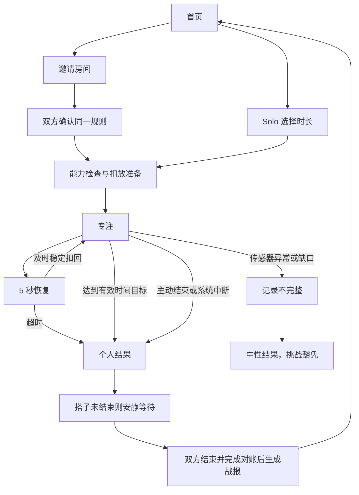

# SAVAGE 页面设计 v0.1

日期：2026-10-15。产品依据：SAVAGE-PRD-v4.1.md。状态：首轮视觉概念与交互规格；尚未实现、尚未做用户可用性测试。

## 1. 设计主张

**开局有趣，专注安静，结算轻松。**

面向北美大学生的英文移动端界面，中文交付说明。沿用熟人一起扣手机的仪式感；先帮助用户开始一段学习，再呈现个性。首页不堆排行榜、商城、签到任务和付费弹窗。

首次用户可直接 Study solo；有固定搭子的用户以 Invite Jamie 等具体行动开局。最近搭子不存在时主行动改为 Invite a friend，不使用虚构头像冒充真实关系。

## 2. 本轮六屏概念

图中 Jamie、25:00 等为示例数据。此图用于评审风格和结构；精确颜色、字号、状态行为以本文和 PRD 为准。

| 页面 | 用户目的 | 主行动 / 次行动 | 必须成立的产品规则 |
|---|---|---|---|
| 01 HOME 首页 | 快速开始学习 | Invite Jamie / Study solo；25/50 分钟 | 最近搭子只是邀请对象，不代表已同意；Solo 首日开放 |
| 02 INVITE 房间 | 让搭子加入并确认规则 | Share invite / Cancel invite | 挑战默认关闭；邀请有到期时间；房间中“加入”与“扣放就绪”分开 |
| 03 READY 准备 | 理解如何扣放并等待双方就绪 | 扣放手机 / Cancel | 只有实际稳定扣放才就绪；拿起即撤销；不做假指纹认证 |
| 04 FOCUS 专注 | 放下手机，把注意力还给学习 | End session 低强调入口 | 不显示实时对手战况；不宣传锁机或后台检测 |
| 05 RESET 恢复 | 在短暂拿起后恢复 | 扣回继续 / End session | 暖色、静态、默认无声；恢复期间暂停有效时间 |
| 06 RECAP 战报 | 理解结果并决定是否再约 | Study together again / Share my result | 先各自时长，后社交；他人信息分享需授权；下一局重新确认 |

首页与历史使用底部两项导航，设置从首页齿轮进入。正式会话页面隐藏全局导航，保留清楚的取消/结束入口。

## 3. 页面流与补充状态

六屏主流程不等于完整上线页面。下一轮原型必须包括以下状态，不能只做成功路径：

| 状态 | 页面显示 | 可执行行动 |
|---|---|---|
| 无搭子 / 首次使用 | Invite a friend；Solo 同屏可见；简短扣放说明 | 分享邀请或 Solo |
| 收到邀请 | 发起人、时长、挑战内容和到期时间 | Accept / Decline；接受后再准备 |
| 挑战开启 | Choose a friendly dare；固定温和选项 | 双方分别同意；任一配置修改撤销旧确认 |
| 对方未加入 | Invitation sent；避免“在线即接受” | 分享、取消或退出等待 |
| 邀请失效 / 房间已满 | 中性原因，无惩罚文案 | 创建新邀请或 Solo |
| 首次校准 | 正面朝上到屏幕朝下的短引导 | 重试或普通计时 |
| 能力不可用 | Gravity tracking unavailable | 普通 Solo 计时；不能伪装完成重力挑战 |
| 等待就绪超时 | Still waiting for your buddy | 取消或转 Solo，不自动开始 |
| 主动结束确认 | End this session?；已记录时间保留 | Keep focusing / End session；确认期间拿起仍依真实规则计时 |
| 个人先结束 | Your 18:20 still counts；搭子仍在专注 | Done；不提供攻击按钮，不打断搭子 |
| 系统失活 | Session ended；具体解释；挑战不适用 | 保存已记录时间并开始新局 |
| 传感器记录缺失 | We couldn't record this part | 查看已记录时间；不生成嘲讽 |
| 离线待同步 | Saved on this phone；Waiting to sync | 重试；不能把离线自动判失败 |
| 战报尚未确定 | Results are syncing | 返回首页；不提前宣布胜负 |
| 一方完成、一方主动中断 | 分列各自时间与原因 | 仅符合 PRD 时显示已同意挑战；吐槽仍须接收者同意 |
| 设置与隐私 | 声音、轻震、减少动态效果、账户、屏蔽、删除 | 默认无声；帮助和退出清楚可达 |

## 4. 可实现的设计规范

建议设计画布以 390 × 844 为主，并检查 360、430 宽度和大字体。屏幕数值是设计基准，不固定真实设备高度。

| Token | 初始值 / 用途 |
|---|---|
| color.background.brand | #120024；首页、邀请、准备、战报 |
| color.background.focus | #08070B；专注和恢复 |
| color.action.primary | #39FF14；搭配近黑文字，用于主行动 |
| color.text.primary | #F6F4F8；一般正文 |
| color.text.secondary | #BEB6C9；说明文字，实际渲染检查对比度 |
| color.feedback.recovery | #F4B860；恢复提示，不用警报红 |
| color.feedback.error | #FF0033；确有错误/危险操作，避免小号红字直接放暗紫底 |
| spacing | 4/8/12/16/24/32/48；屏幕水平边距 24 |
| radius.control | 14；按钮、选择控件统一 |
| touch-target | 设计目标至少 48 × 48；文字链接也保留触控区 |
| typography.heading | 英文凝练粗体，拟用 Barlow Condensed；正式接入核对字体文件许可 |
| typography.body | 原生优先平台 UI 字体，网页采用可读 sans-serif fallback；正文 16 起 |
| typography.timer | 等宽数字，64–96，随宽度缩放；不要用字号固定导致裁切 |
| motion | 仅操作反馈约 160–220 ms；减少动态效果时去除非必要动画 |

字体和插画尚为概念，不把生成图中文字切成图片交付。实际控件必须用原生文本/组件实现，以支持可访问性和动态字体。熊单独产出资产后再进入代码。

按钮原则：每页一个高强调行动；取消/结束可发现但不抢视线。静音计时页不需要循环动画，剩余时间随有效扣放累计更新。

## 5. 六屏的关键文案与行为

- Home：`Phones down. Show up.`；`Invite Jamie`；`Study solo`；`Invite someone else`。空列表时不显示 Recent buddy。
- Invite：`Your study room`；`Friendly dare` 默认 Off；`No challenge unless you both agree.`。单纯开关不等于达成协议，启用后必须选择内容并由双方确认。
- Ready：`Flip to begin.`；`Keep SAVAGE open. Place your phone face down.`；`Starts when both phones are ready.`。屏幕朝上时显示 Place phone down，不能继续显示本机 Ready。
- Focus：`Focusing`；剩余有效时间；`End session`。不用“对手在线”推断其学习行为。
- Reset：`Phone up.`；`Flip back to continue.`；`Your focus time is paused.`。数字与传感器时间戳一致，动画没有裁判权限。
- Recap：仅双方都完成才显示 `You both showed up.`；个人中断显示 `Your 18:20 still counts.`。默认分享只包含本人；分享成功不等于朋友已看到。

## 6. 概念图审查与下一步细化

已检查生成图中的六屏完整性、主行动、文字可读性、品牌/专注阶段变化、恢复暖色、战报时长与 Solo 入口。图中未出现真钱、榜单或专注期间攻击。

以下是从概念进入逐屏稿前的具体修正项，不把首版概念视为最终像素规范：

1. 概念图背景带有轻微质感和色差；实施时使用 token 中的纯色，不复制压缩/生成纹理。
2. 专注倒计时在图中偏亮；下一版降低视觉强度，同时保留可读性并实测对比度。
3. Invite 中 `Ready to join` 改为 `Joined`（房主），避免与传感器 READY 混淆；对方仍为 Invitation sent。
4. Ready 中本机 Ready 只是状态示意；真实拿起查看时需立即变为 Place phone down。补齐 Waiting、Ready、Starting 三种画面。
5. 图中文字较多采用凝练字体；正式页面只让标题和数字保留这种风格，正文/按钮用更清晰的 UI 字体。
6. 此总览用于方向评审；下一步为首页、准备、异常结果分别生成/制作可读的独立尺寸稿，再做交互原型。

## 7. 交互原型验收目标

- 新用户不依赖解释能找到 Solo 和邀请入口，并理解这是记录扣放时间。
- 25/50 分钟、开关、邀请、取消、接受、结束、重新约局都实际改变本地演示状态。
- 原型的“模拟扣放/断网/系统中断”放在独立演示控件区，不混入正式 App 页面。
- 检查正常完成、恢复成功、恢复超时、系统失活、离线待同步五条路径。
- 长昵称、大字体、小屏没有遮挡主行动；颜色不是唯一状态提示；支持减少动态效果。
- 分享他人信息先检查授权，默认分享本人；中断、未知结果不生成羞辱性惩罚。
- 完整实现后需要浏览器截图和交互检查；本轮只有概念图，不能声称上述验收已通过。

## 8. 资产与生成记录

- 图稿：`../design/concepts/savage-core-screens-v1.png`。
- 提示词：`../design/concepts/savage-core-screens-v1.prompt.txt`。
- 方式：内置 Imagegen，非 CLI；生成后保留原文件并复制至项目。
- 说明：此图不是 Figma 图层，不代表候选插件的生成效果或已验证的 App 功能。
