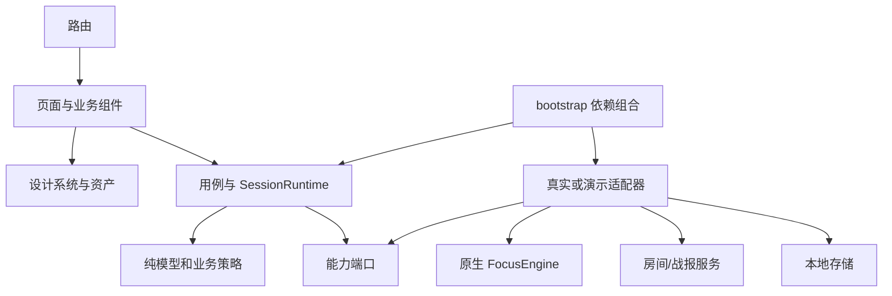

# SAVAGE 客户端架构参考

关联：[阶段设计](2026-10-15-phase-1-client-structure-design.md)、[PRD v4.1](../SAVAGE-PRD-v4.1.md)、[页面 v0.2](../SAVAGE-Page-Design-v0.2.md)。

## 1. 架构目标与阶段边界

一个 React Native + TypeScript 客户端，Expo Router 提供 iOS/Android/Web 路由。先以 Web 演示验证页面；使用开发构建接入本地 Swift/Kotlin 模块验证原生能力。Expo Go 可以辅助普通 UI 浏览，但不作为自定义 FocusEngine 的验收环境。

本轮只设计结构，没有安装依赖或创建 App。第一阶段优先减少重写与耦合，不追求将页面工程预先拆成大量 package。跨端复用包括 UI、文案、类型、用例、结果展示和协议；传感器、可靠生命周期截断与本地时钟实现属于平台代码。

## 2. 拟建目录

```text
savage/
├─ docs/                              # 产品、视觉与架构文档
├─ design/concepts/                   # 评审图；不是运行时 UI 背景
├─ src/
│  ├─ app/                           # Expo Router 路由，薄层组合
│  │  ├─ _layout.tsx                 # AppProviders + 根导航
│  │  ├─ (tabs)/
│  │  │  ├─ _layout.tsx              # Focus / History
│  │  │  ├─ index.tsx                # HomeScreen
│  │  │  └─ history.tsx
│  │  ├─ rooms/[roomId]/index.tsx    # 邀请、规则确认、准备状态
│  │  ├─ sessions/[sessionId].tsx   # 专注/恢复/个人结果按快照渲染
│  │  ├─ reports/[reportId].tsx     # 联合战报
│  │  ├─ invite/[token].tsx         # 链接接收；加入前校验
│  │  ├─ settings.tsx
│  │  └─ +not-found.tsx
│  ├─ bootstrap/
│  │  ├─ AppProviders.tsx            # 依赖注入与启动恢复
│  │  ├─ createServices.ts           # 真实/演示依赖组合唯一入口
│  │  └─ config.ts                  # 启动配置，缺配置显式报错
│  ├─ design-system/
│  │  ├─ tokens/                    # colors、spacing、type、radius、motion
│  │  ├─ themes.ts                  # light / focus / recovery
│  │  ├─ primitives/                # Text、Button、Screen、Divider、Avatar
│  │  └─ icons/                     # 统一图标，保持同一笔触
│  ├─ features/
│  │  ├─ home/                      # screens、components、hooks
│  │  ├─ room/                      # 邀请、同意、准备、能力提示
│  │  ├─ session/                   # 专注、恢复、个人结果
│  │  ├─ report/                    # 联合结果、分享、贴纸同意
│  │  ├─ history/                   # 记录和证据/同步标签
│  │  └─ settings/                  # 偏好、帮助与未来账户入口
│  ├─ application/
│  │  ├─ room/                      # createInvite、acceptInvite、confirmRules
│  │  ├─ session/                   # SessionRuntime、startSolo、endSession
│  │  ├─ report/                    # loadReport、prepareShare、rematch
│  │  └─ sync/                      # 上传、退避、对账、游标恢复
│  ├─ domain/
│  │  ├─ session/                   # 模型、原因、快照、记录来源
│  │  ├─ room/                      # 房间、配置版本、同意快照
│  │  ├─ report/                    # 联合结果与授权模型
│  │  └─ rules/                     # 规则版本、纯策略、显示资格判断
│  ├─ ports/                        # 外部能力合约，不含具体 SDK
│  │  ├─ FocusEngine.ts
│  │  ├─ RoomGateway.ts
│  │  ├─ ReportGateway.ts
│  │  ├─ HistoryRepository.ts
│  │  ├─ ShareService.ts
│  │  └─ PreferencesRepository.ts
│  ├─ adapters/
│  │  ├─ focus/                     # NativeFocusEngine / SimulatedFocusEngine
│  │  ├─ network/                   # HTTP/实时通道，运行时响应校验
│  │  ├─ storage/                   # UI 缓存、偏好；平台文件隔离
│  │  └─ share/                     # native/web 差异
│  ├─ demo/                         # 假网关、场景、独立演示面板
│  ├─ assets/                       # 独立熊/手机素材、字体
│  ├─ i18n/en.ts                    # 英文文案及无障碍标签
│  └─ shared/                       # 格式化/小型通用结果类型；禁止杂物堆
├─ modules/savage-focus/            # 原生探针阶段建立
│  ├─ src/                         # TS 桥接口和事件定义
│  ├─ ios/                         # Swift：检测、生命周期、时钟、日志
│  └─ android/                     # Kotlin：对应实现
├─ tests/
│  ├─ rules/                       # 纯规则与虚拟时钟
│  ├─ contracts/                   # 引擎、网络契约和去重
│  ├─ fixtures/                    # 两端共享输入轨迹与预期结果
│  ├─ integration/                 # 用例 + 假端口
│  └─ e2e/                         # 页面主流程及异常
├─ app.config.ts                   # 实现时建立
├─ package.json                    # 实现时建立，使用一个包管理器
└─ tsconfig.json                   # strict；兼容框架版本
```

第一批仅建立真实需要的文件；原生、网络、分享等后续模块以本文预留，不一次创建几十个空壳。`ios/`、`android/` 生成工程是否纳入版本控制，在原生模块工作时确定；自定义逻辑放本地 module/config plugin，不依赖手改易被重新生成覆盖的文件。

## 3. 依赖方向与职责



箭头表示代码依赖/组合，不表示传感器消息方向。实际数据流为原生事件 → runtime → 页面快照。

- `domain` 不导入 React、Expo、HTTP 或存储 SDK。
- `features` 不直接读取传感器、启动 WebSocket 或写数据库；也不跨 feature 导入内部组件。
- `application` 通过端口访问外部服务；`bootstrap` 是选择真实/模拟实现的唯一位置。
- `adapters` 不能反向依赖页面；错误转为可识别的业务原因，由页面决定文案。
- 时间格式、按钮和头像可以复用；联合战报逻辑、房间确认逻辑不塞入通用 UI 组件。

## 4. 从设计图到页面组件

| 图稿 / 状态 | Screen | 主要组件 | 数据来源 |
|---|---|---|---|
| HOME | HomeScreen | BrandHeader、BearArtwork、DurationSelector、RecentBuddyRow、PrimaryButton | 最近搭子/偏好；首屏无关系时显式空态 |
| INVITE | RoomScreen | ParticipantRow、ChallengeSettings、InviteExpiry、RoomActions | RoomGateway 的版本化快照 |
| READY | PreparationScreen | FlipGuide、CapabilityNotice、ReadyStatusList | 房间同意 + 引擎能力/姿态；Joined 与 Ready 分开 |
| FOCUS | FocusScreen | FocusTimer、EndSessionAction | FocusEngine 快照，只显示本机 |
| RESET | RecoveryScreen | RecoveryCountdown、RecoveryInstruction | 同一会话快照及恢复截止时间 |
| 个人结束/等待 | PersonalResultScreen | EffectiveTimeSummary、EndReasonNotice、BuddyPendingNotice | 本机结果 + 可滞后的远端进度 |
| RECAP | ReportScreen | ParticipantResultRow、EvidenceLabel、RematchAction、ShareAction | 有版本的联合报告 |
| 历史 | HistoryScreen | SessionHistoryRow、EmptyHistory、SyncLabel | 可重建的历史投影 |
| 设置 | SettingsScreen | PreferenceRow、HelpLinks、AccountSection | 偏好；真实账户操作后续接入 |

同一个 `sessions/[sessionId]` 路由根据状态渲染 Focus / Recovery / PersonalResult，不给这三种视觉状态创建独立路由历史。返回按钮不能把终态退回计时态。房间页同样依据快照切换邀请/确认/准备子视图。

对深链直接进入正在进行或已结束会话，先恢复快照再选择视图；加载期间显示恢复中。未知 ID 显示不可用，不自动创建新会话。

## 5. 三类状态，三个不同来源

| 状态 | 所有者 | 例子 | 禁止 |
|---|---|---|---|
| 临时交互 | 页面组件 | 对话框是否展开、时长草稿 | 以草稿代表双方同意 |
| 本机运行 | SessionRuntime 订阅 FocusEngine | 有效时间、恢复截止、结束原因 | 页面各自维护倒计时事实 |
| 服务端资源 | Room/ReportGateway 缓存 | 参与者、configVersion、报告版本 | WebSocket 断开直接判朋友失败 |

SessionRuntime 生命周期位于 App 根层，不跟随某张页面 mount/unmount。它不代表后台继续计时：真实设备的活跃前台边界由原生引擎立即处理，React 的 AppState 仅用于界面响应与二次对齐。

框架刷新定时器只触发绘制。页面不执行 `每秒 +1`，也不直接以 Date.now 差值记有效时间。UI 插值仅展示已知活跃区间；以引擎周期快照校正，遇到证据空档停止外推。最终结果从引擎重读。

## 6. 关键模型与约束

| 模型 | 关键字段 / 语义 |
|---|---|
| SessionConfig | sessionId、mode、targetMs、ruleVersion、algorithmVersion、configVersion、startTimezone、可选 roomId |
| SessionSnapshot | runtimeState、effectiveMs、recoveryDeadline、wallDeadline、outcome、endReason、evidence、syncStatus、revision、recordSource |
| EngineEvent | eventId、sessionId、seq、clockEpoch、monotonicMs、type、可信区间/缺口、规则版本 |
| RoomSnapshot | roomId、version、参与者、target、challengeSnapshot、各自同意的 configVersion、准备状态 |
| StartCommit | startToken、scheduledStartAt、截止时间、配置版本、参与者确认、可比较性 |
| Report | reportId、version、provisional、双方摘要、challengeOutcome、各自对该版本的 shareConsent |
| RecordSource | device / manual_timer / simulation / self_report；来源不能通过“同步成功”更换 |

`runtimeState` 与结果、证据、同步三个维度独立。未收到朋友记录的状态是未知/待同步，不是中断。`UNVERIFIED_END` 是运行终态；outcome 可以 unknown，evidence 为 partial/unverified，不硬塞进失败。

普通 Solo 的 manual_timer 不依赖姿态；必须显示“普通计时”，不加入重力挑战，也不冒充完整设备扣放记录。具体成长资格沿用 PRD，新增普通计时成就需另行定义。

设备内部使用单调时钟；所有原生事件和快照共享同一个 clockEpoch。JS `performance.now()` 与原生时钟不能直接相减；需要由适配器提供时间映射和不确定度。重启或不可确定的时钟重建必须生成新 epoch，不拼接区间。

## 7. FocusEngine 端口

这个接口是将来原生模块和当前演示版的共同契约，不是声称 Expo 已提供相同 API。

| 操作 | 责任 |
|---|---|
| getCapabilities | 返回传感器、前台观测、时钟与日志能力以及算法版本 |
| prepare | 固定会话规则，开始准备阶段检测；未开始不累计 |
| scheduleStart | 校验开始凭据/截止和本机 ready 状态，映射开始时间 |
| end / cancel | 明确区分开始后结束与开始前取消；重复调用幂等 |
| subscribe / getSnapshot | 订阅通知 + 拉取权威快照，带 revision；迟到旧快照不覆盖新值 |
| restore | 从日志恢复结果；不自动将旧终态重启为 FOCUSING |
| readPendingEvents / acknowledge | 按批读取持久事件；只有服务器确认后推进已上传游标 |
| release | 释放传感器/唤醒资源；重复执行安全 |

**真实引擎：** Swift/Kotlin 持有采样、去抖、朝向/稳定性、生命周期截断、单调时间、可信区间和事务日志。即使 JS 暂时繁忙，不能按 JS 收到事件的时间伪造中断时刻。失活立即停止并释放唤醒，不借此延伸后台采样。

**演示引擎：** 使用虚拟时钟和场景事件生成同构快照，所有记录标 simulation。它只用于交互和合约测试，不能通过浏览器传感器权限变为 device。`demo` 控件与正式页面隔离，在专用开发入口显示明确的“交互演示”标记。

原生桥不必高频逐样本传 JS。原生按需要采样；状态变化立即通知，UI 约每秒更新显示即可。订阅丢失后通过快照和日志恢复，不能依赖每一条临时通知都送达。

原生规则与 TS 模拟器可能发生实现偏差：用共享 fixtures 表达朝向、时间、生命周期输入及预期结果，由 Swift、Kotlin、TS 各自执行同一轨迹。模拟器通过不等于两端已通过。

## 8. 会话转换与边界

| 事件 | 状态变化 | 副作用 |
|---|---|---|
| 能力/规则满足，稳定扣放 | PREPARING → READY | 发送就绪；不计准备的 2 秒 |
| 拿起或配置变化，尚未开始 | READY → PREPARING | 撤销本机就绪/旧确认 |
| 有效开始提交到达且时间满足 | READY → FOCUSING | 同一 startToken 只启动一次 |
| 连续偏离确认 | FOCUSING → RECOVERY | 从首次偏离起暂停累计；去抖包含在 5 秒内 |
| 截止前完成重新稳定 | RECOVERY → FOCUSING | 恢复区间不补计 |
| 恢复超时或明确结束 | → INTERRUPTED | 保留时间；不停止朋友 |
| 电话/锁屏/失活 | → INTERRUPTED | system_inactive，挑战豁免，立即释放资源 |
| 传感器缺口或无法恢复 | → UNVERIFIED_END | 截断至可靠样本，不填补缺失 |
| 有效时间达到目标 | → COMPLETED | 固化结果；停止增长 |
| 个人墙钟达到目标 + 60 秒 | → EXPIRED | 保留时间，挑战豁免 |

同一边界冲突时按可信事件时间处理：先截断到最早中断，再看此前是否达到目标；不能按桥接消息抵达顺序裁判。恢复成功要求重新稳定窗口在截止前完成，不能仅凭 5 秒以内出现一个朝下样本。

截止和计时判断独立于动画帧率。终态不可回到 FOCUSING；新一局始终使用新 sessionId。

## 9. 持久化与同步

**单一记录写入方：** 原生引擎拥有会话日志及其事务。区间、序号、快照和待上传事件在同一事务提交；UI 不通过另一套数据库写入同一批事实。建议每 5 秒及状态转换落盘，失活尽力立即落盘，未保存片段按缺失处理。

**缓存分开：** 历史列表、房间快照、偏好可以通过平台 Repository 缓存；它们不是计时原始账本。原生缓存可评估 expo-sqlite，Web 演示用独立 IndexedDB 实现；不把 SQLite Web 支持当成原生日志等价能力。原生日志由本地模块持有，不能依赖 JS 在挂起前必然完成写入。[Expo SQLite 文档](https://docs.expo.dev/versions/latest/sdk/sqlite/)

**本地到远端：** runtime/sync 读取已落盘批次 → 发送服务器 → 校验确认 → 原子推进上传游标。崩溃在确认前只会导致重传；服务器用 eventId、sessionId+seq 去重并合并不重叠区间。永久无效事件明确标记并上报，不无限卡住队列。

**远端到页面：** 房间/报告消息带版本；版本断档先请求完整快照，旧消息忽略。网络连接状态单独存储，不覆盖 record evidence。离线前台可继续本地记录，但不能离线创建新的双人共同开始。

**战报：** 只有双方结果确定后生成最终版本；缺一端先给暂定报告。最晚个人截止 + 120 秒缓冲和 24 小时补传窗口按 PRD；客户端不能自行将暂定报告升级。后续更新报告需新版本，原共享授权不自动迁移。

**账户退出：** 未来账户绑定的缓存/队列按所有者隔离；退出不能让下一位登录者看到或上传前一个人的事件。模拟记录永不送往正式端点，正式服务器也拒收 simulation 来源。

## 10. 房间与服务端责任

| 客户端用例 | 服务端责任 | 页面处理 |
|---|---|---|
| createInvite / acceptInvite | 身份、参与者、过期、重复互邀、屏蔽校验 | 显示等待/拒绝/失效；不把发送等同接受 |
| updateConfig / confirmRules | 乐观版本校验、清空旧同意、固定规则快照 | 冲突刷新并重新确认 |
| setReady / coordinateStart | 准备确认、未来开始时刻、最终提交和确认追踪 | 错过提交不追溯计时；不可比较时豁免 |
| uploadSessionEvents | 去重、时长合法性、版本、权限 | 本地继续；同步状态变化不变更本机事实 |
| getReport / consentShare | 权威报告、版本授权、撤销与过期 | 分享默认仅本人，服务端重新校验 |

不是分布式原子同时开局。任一端未收到提交或偏差超限时，能开始的一端可保留个人记录；联合挑战不适用。推送只是提醒，不能替代可信开始提交。

端口错误统一为可处理类别：expired、conflict、blocked、unauthorized、offline、unavailable、invalid_record。网络层校验响应形状，TypeScript 静态类型不能代替输入验证。正式鉴权和账户删除 API 在后续服务端设计中展开。

## 11. 视觉系统落地

主 token：background #FAF9F5、text #242328、secondary #64616A、primary #C5F36B、accent #E8E2FB、focus #242B29、recovery #DDE6DB。18 圆角、24 水平边距、48 最小触控设计目标；字号与行高支持系统缩放。

`Screen` 负责 safe area、背景、滚动与横向边距；`AppText` 管理标题/正文/说明/数字；`Button` 管理 primary/secondary/quiet/destructive 与 loading/disabled。每个 feature 不重复硬编码颜色和按钮样式。

主题是阶段语义，不是全局开关强制全 App 反色。Focus/Recovery 共享可调的 calm 视觉配置，便于明暗刺激测试。默认无声无震动、减少动态效果受系统设置控制；纯动画不驱动业务状态。

手机图、熊图和字体单独管理；图片有无障碍用途说明或标装饰。英文字符串集中管理，含长昵称和数值插值，禁止把昵称拼入图片。生成总览图仅作为视觉参考，不当页面底图。

## 12. 测试与实施顺序

| 顺序 | 产物 | 核心检查 |
|---|---|---|
| 1 | 最小 Expo 工程、token、基础组件、Home/Room | 页面还原、触控、长文本与无障碍 |
| 2 | 类型、端口、模拟引擎、SessionRuntime | 虚拟时钟、恢复边界、终态与副作用幂等 |
| 3 | Ready/Focus/Recovery/PersonalResult/Report | 整条路径可操作，状态切换无导航假恢复 |
| 4 | Web 演示场景、历史、设置与异常 | 失活、缺口、离线、个人先结束、待同步 |
| 5 | Android/iOS 独立原生探针 | 时间来源、双面方向、JS 繁忙、失活、崩溃/重启、50 分钟耗电 |
| 6 | 真机引擎接入、真实房间/报告服务 | PRD AC-01～22/24，双平台混局和权限 |

原生探针在 UI 完整精修前尽早开始，不能等全部页面开发完才发现核心机制不可用。各层测试工具在初始化时选择与 Expo SDK 兼容的版本：规则/组件采用 Jest 体系与 React Native Testing Library；Web 主流程可用浏览器自动化；原生仍需平台测试和真机脚本。

优先规则用例：恢复 5 秒前/边界/后；完成与失活同刻；配置变更撤销 ready；两次开始/结束；旧 revision 到达；网络断开不降 evidence；重启不拼接 epoch；重复上传不加时间；本人先结束不干扰朋友；报告更新使联合分享重新取授权。

## 13. 官方能力依据与限制

- [Expo 开发构建](https://docs.expo.dev/develop/development-builds/introduction/)：可纳入自定义原生依赖，需对应平台构建链；Windows 本身不提供 Xcode。
- [Expo Modules API](https://docs.expo.dev/modules/overview/)：本地 Swift/Kotlin 模块扩展路径；本文 FocusEngine 的能力是拟实现契约。
- [Expo Router](https://docs.expo.dev/router/introduction/)：跨 iOS、Android、Web 的统一导航。
- [React Native 平台差异代码](https://reactnative.dev/docs/platform-specific-code)：共享部分与平台文件的拆分机制。

版本与账户服务尚未选定。没有因采用 Expo 就取得可靠后台记录、App Store 审核通过或双端性能达标的保证。本架构保留 PRD 的活跃前台约束。

## Intent Contract

- intent: 为已确认的浅色页面提供可实施的客户端职责、目录和协议边界。
- constraints: 本文继承阶段设计；真实计时不由 React 页面持有，演示数据不进入正式记录。
- success_criteria: 页面、状态、存储和平台端口均有明确归属，并能对应 PRD 验收项。
- risk_level: medium

## Verification Contract

- verify_steps: 运行文档结构检查、相对链接检查，并人工核对第 4～10 节与 PRD 的状态/异常要求。
- check: 本文没有将拟建目录写成已创建的代码，也没有将演示验证写成真机验证。
- confirm: 后续实现分别提供规则、页面、真机和服务端证据，见第 12 节。

## Governance Contract

- approval_gates: 当前范围仅架构设计；依赖安装、真实服务接入与发布遵循后续具体任务授权。
- rollback: 本文可独立修订，保留已确认图稿和 PRD；没有运行时迁移。
- ownership: 本文与阶段设计共同维护，架构规则变更必须同步对应合约和验收项。
